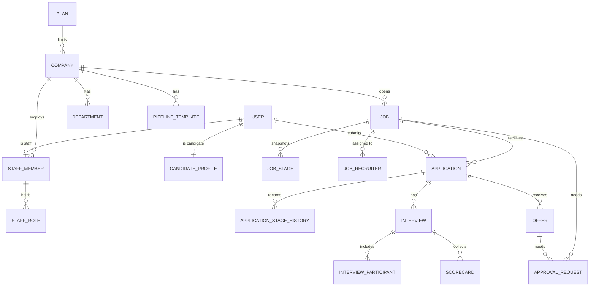

# Data Model

## Master Data vs. Transactional Data

A useful split for most business apps:

- **Master data** — relatively stable reference/core entities that other things point to.
  Changes rarely, usually via an admin flow. Examples: users, products, categories, accounts,
  price lists, org units.
- **Transactional data** — records of things that happened, usually time-stamped and
  append-heavy, referencing master data by ID. Examples: orders, payments, bookings, audit logs,
  sessions.

Why it matters for AI-assisted builds: master data usually needs full CRUD + validation +
admin UI; transactional data usually needs create + read + (rarely) reversal/correction, but
almost never update-in-place or delete — get this distinction into the spec and Claude won't
generate an "edit order" screen you didn't want, or skip audit trails on data that needed one.

## Conventions for every table

- Primary keys are UUIDs (`id`). Every table has `created_at` and, if mutable, `updated_at`,
  stored in UTC (`timestamptz`).
- **Company-owned** tables carry `company_id` (FK → `companies`, `NOT NULL`). Company scoping is
  applied centrally (see `security.md` > Authorization), never by hand per query.
- Tables marked **versioned** have an integer `version` column for optimistic locking (see
  `operations.md` > Concurrency).
- Global (not company-owned) tables: `plans`, `companies`, `users`, `candidate_profiles`,
  `cv_documents` (profile CVs). A company reaches candidate data **only** through an
  `applications` row to that company.
- Enum values below are the full set; adding one is a migration.

## Entities

### Plan — Master (global)

- **Purpose:** A subscription tier with usage limits. No billing.
- **Key fields:** `id`, `name` (unique), `max_active_jobs`, `max_staff_seats`, `is_active`.
- **Relationships:** has many Companies.
- **Lifecycle:** Created/edited by super-admin (or seed). Never deleted; deactivated instead.
- **Delete/cascade:** Delete blocked while any company references it.
- **Constraints:** limits > 0. Seeded plans: Free (2 jobs / 3 seats), Pro (10 / 15),
  Business (50 / 100). Downgrades below usage are grandfathered (see `functional.md`).

### Company — Master (global)

- **Purpose:** A tenant. Everything company-owned hangs off it.
- **Key fields:** `id`, `name`, `slug` (unique, URL-safe, used in `/careers/<slug>`), `plan_id`,
  `status` (`active`, `suspended`), `suspended_at`, `currency` (ISO 4217), `time_zone` (IANA),
  `retention_months` (nullable), `brand_color`, `logo_blob_name` (nullable), `careers_intro`,
  `version`.
- **Relationships:** belongs to Plan; has many Departments, StaffMembers, Jobs, templates.
- **Lifecycle:** Created by super-admin. Suspended/reactivated, never hard-deleted in v1.
  Versioned. Audited (settings).
- **Delete/cascade:** No delete in v1. [TODO — company offboarding/deletion is out of scope until
  decided.]
- **Constraints:** `slug` unique; immutable for company admins (only the super-admin can change
  it);
  `brand_color` must pass a contrast check against white text (see `ui-guidelines.md`).
- **Status change timestamps:** `suspended_at`; reactivation recorded in the audit log.

### User — Master (global)

- **Purpose:** One person who can sign in. Links the External ID identity to TalentFlow.
- **Key fields:** `id`, `external_id` (External ID `oid`, unique, nullable until first sign-in for
  pre-created staff), `email` (unique, case-insensitive — `citext`), `display_name`,
  `is_platform_admin` (bool, set only by seed/CLI), `last_login_at`, `anonymized_at`.
- **Relationships:** has at most one StaffMember; has at most one CandidateProfile.
- **Lifecycle:** Candidates are created on first sign-in; staff are pre-created by an admin and
  linked on first sign-in by email.
- **Delete/cascade:** Never hard-deleted; GDPR deletion anonymizes (see Data Retention).
- **Natural/external key:** `external_id` (External ID), `email` (matching key for staff import
  and first-login linking).
- **A user is staff or a candidate, never both:** a user can't have both a StaffMember and a
  CandidateProfile. Creating a staff member for an email that has a CandidateProfile is rejected.

### StaffMember — Master (company-owned)

- **Purpose:** A user's membership of one company as staff.
- **Key fields:** `id`, `company_id`, `user_id` (unique — one company per staff user),
  `department_id` (nullable), `is_active`, `deactivated_at`, `version`.
- **Relationships:** belongs to Company, User, Department; has many StaffRoles.
- **Lifecycle:** Created by company admin or CSV import. Deactivated, never deleted.
- **Delete/cascade:** Deactivation blocked while the member holds open items (see
  `functional.md` > Staff deactivation). The last active company admin can't be deactivated.
- **Status change timestamps:** `deactivated_at`. Reactivation is allowed: roles are kept (StaffRole
  rows aren't removed on deactivation), `deactivated_at` cleared, seat limit checked.
- **Bulk operations:** see Bulk Operations below.
- **Not audited** (decision: users & roles changes are tracked only via `import_runs` for
  imports, not the audit log).

### StaffRole — Master (company-owned)

- **Purpose:** One role held by a staff member.
- **Key fields:** `staff_member_id`, `role` (`company_admin`, `recruiter`, `hiring_manager`,
  `interviewer`), `company_id`.
- **Constraints:** unique (`staff_member_id`, `role`).
- **Delete/cascade:** Removing a role is blocked under the same rule as deactivation when the
  member holds open items that need that role.

### Department — Master (company-owned)

- **Key fields:** `id`, `company_id`, `name`, `salary_cap` (money, company currency), `version`.
- **Constraints:** unique (`company_id`, `name`).
- **Lifecycle:** Admin CRUD. Audited.
- **Delete/cascade:** Delete blocked while referenced by jobs or staff; archive instead
  [TODO — add `archived_at`?].

### PipelineTemplate / PipelineTemplateStage — Master (company-owned)

- **Purpose:** Reusable stage lists that jobs copy on creation.
- **Key fields:** template: `id`, `company_id`, `name`, `is_default`, `version`. stage:
  `id`, `template_id`, `name`, `position`, `kind` (`applied`, `normal`, `interview`, `offer`,
  `hired`), `interview_kit_id` (nullable).
- **Constraints:** exactly one `applied`, one `offer`, one `hired` stage per template; positions
  unique per template; one default template per company. `rejected` and `withdrawn` are
  application **statuses**, not stages.
- **Lifecycle:** Admin CRUD. Audited. Edits never affect existing jobs (snapshot).
- **Delete/cascade:** Delete blocked while it's the company default; otherwise allowed (jobs hold
  copies).

### InterviewKit / InterviewKitCompetency — Master (company-owned)

- **Key fields:** kit: `id`, `company_id`, `name`, `questions` (ordered text list). competency:
  `id`, `kit_id`, `name`, `position`.
- **Lifecycle:** Admin CRUD. Audited.
- **Delete/cascade:** Job stages hold a copy of the kit content made at job creation, so kit
  edits only affect new jobs. Delete blocked while a template stage references it.

### EmailTemplate — Master (company-owned)

- **Key fields:** `id`, `company_id`, `event` (`application_received`, `interview_invite`,
  `interview_changed`, `offer_sent`, `rejection`, `talent_pool_invite`), `subject`, `body`
  (template with a fixed set of placeholders), `version`.
- **Constraints:** unique (`company_id`, `event`). New companies get platform defaults.
- **Lifecycle:** Admin edits. Audited. Rendered with autoescaping (see `security.md`).

### Job — Master-like (company-owned)

- **Purpose:** A requisition and its public posting.
- **Key fields:** `id`, `company_id`, `department_id`, `title`, `location`, `employment_type`
  (`full_time`, `part_time`, `contract`, `internship`), `remote_policy` (`onsite`, `hybrid`,
  `remote`), `salary_min`, `salary_max`, `headcount`, `hired_count`, `description`,
  `requirements`, `hiring_manager_id` (→ StaffMember), `pipeline_template_id` (source, info
  only), `status` (`draft`, `pending_approval`, `approved`, `published`, `paused`, `closed`),
  `published_at`, `closed_at`, `version`.
- **Relationships:** has many JobStages, JobRecruiters, Applications, ApprovalRequests.
- **Lifecycle:** Edited in place; every field change audited. Never deleted once published;
  drafts can be deleted.
- **Constraints:** `salary_min` ≤ `salary_max`; `hired_count` ≤ `headcount`; publishing requires
  `approved` and plan capacity.
- **Status change timestamps:** `published_at`, `closed_at`; full transitions in the audit log.

### JobRecruiter — Master (company-owned)

- **Purpose:** Assignment of recruiters to a job — the data scope for recruiter **write** access.
- **Key fields:** `job_id`, `staff_member_id`, `company_id`. Unique pair.
- **Constraints:** a non-closed job has at least one recruiter.

### JobStage — Master (company-owned)

- **Purpose:** The job's own snapshot of its pipeline stages.
- **Key fields:** `id`, `job_id`, `company_id`, `name`, `position`, `kind`,
  `interview_kit_snapshot` (JSON: questions + competencies, nullable).
- **Delete/cascade:** Delete blocked while any active application is in the stage.

### CandidateProfile — Master (global)

- **Purpose:** The candidate's own, current profile.
- **Key fields:** `id`, `user_id` (unique), `first_name`, `last_name`, `phone`, `location`,
  `headline`, `links` (JSON list), `current_cv_document_id`, `anonymized_at`.
- **Lifecycle:** Candidate edits freely. Anonymized on GDPR deletion.

### CvDocument — Transactional

- **Purpose:** One uploaded CV file and its parse result.
- **Key fields:** `id`, `owner_user_id`, `blob_name` (generated, see `security.md`),
  `original_filename` (display only), `content_type`, `size_bytes`, `sha256`, `parse_status`
  (`pending`, `parsed`, `failed`), `parsed_at`, `parsed_data` (JSON: work history, education,
  skills), `text_content`, `search_vector` (tsvector).
- **Lifecycle:** Never edited after parse except by re-parse. Deleted (row anonymized, blob
  removed) on GDPR deletion or retention purge.

### Application — Transactional (company-owned)

- **Purpose:** One candidate's application to one job.
- **Key fields:** `id`, `company_id`, `job_id`, `candidate_user_id`, `current_stage_id`
  (→ JobStage), `status` (`active`, `rejected`, `withdrawn`, `hired`), `source`
  (`careers_page`, `talent_pool_invite`, `direct_link`), `rejection_reason`
  (`not_enough_experience`, `skills_mismatch`, `better_qualified_candidate`,
  `salary_expectations`, `location_availability`, `position_filled`, `other`), `rejection_note`, `hire_decision` (`hire`, `no_hire`,
  null), `hire_decided_by`, **snapshot fields** (proposed — see `functional.md` > Apply):
  `snapshot_profile` (JSON), `snapshot_cv_document_id`, timestamps `applied_at`,
  `rejected_at`, `withdrawn_at`, `hired_at`, `last_activity_at`, `anonymized_at`, `version`.
- **Relationships:** belongs to Job, JobStage, User; has many StageHistory, Notes, Interviews,
  Offers.
- **Lifecycle:** Created by candidate. Updated only through defined transitions (move, reject,
  withdraw, hire). Never deleted; anonymized.
- **Constraints:** partial unique index on (`candidate_user_id`, `job_id`) `WHERE status =
  'active'`; `current_stage_id` belongs to the same job.
- **Status change timestamps:** yes — listed above, plus stage-level history in
  `application_stage_history`.

### ApplicationStageHistory — Transactional (company-owned)

- **Purpose:** Every stage move and status change. Doubles as the application audit trail and
  the source for funnel / time-to-hire reports.
- **Key fields:** `id`, `company_id`, `application_id`, `from_stage_id`, `to_stage_id`,
  `from_status`, `to_status`, `actor_user_id` (null for candidate/system actions, with
  `actor_kind`: `staff`, `candidate`, `system`), `reason`, `occurred_at`.
- **Lifecycle:** Append-only. Never edited or deleted (survives anonymization).

### ApplicationNote — Transactional (company-owned)

- **Key fields:** `id`, `company_id`, `application_id`, `author_staff_id`, `body`, `created_at`,
  `edited_at` (shown as "edited").
- **Lifecycle:** The author can edit or delete their own notes; company admins can delete any
  note. Deleted on anonymization. Never visible to staff outside the job's scope; included in the
  candidate's GDPR export.

### Tag / CandidateTag — Master / Transactional (company-owned)

- **Purpose:** Company-specific labels on talent-pool candidates.
- **Key fields:** tag: `id`, `company_id`, `name` (unique per company). candidate_tag:
  `company_id`, `candidate_user_id`, `tag_id`, `added_by`, `added_at`.
- **Delete/cascade:** Deleting a tag cascades to its CandidateTags. Removed on anonymization.

### Interview — Transactional (company-owned)

- **Key fields:** `id`, `company_id`, `application_id`, `job_stage_id`, `status` (`proposed`,
  `scheduled`, `completed`, `cancelled`), `duration_minutes`, `meeting_link` or `location`,
  `starts_at`, `ends_at` (set when booked), `scheduled_by`, `cancelled_reason`, `version`.
- **Relationships:** has many InterviewSlotProposals, InterviewParticipants, Scorecards,
  RescheduleRequests.

### InterviewSlotProposal — Transactional (company-owned)

- **Key fields:** `id`, `interview_id`, `starts_at`, `ends_at`, `company_id`.

### InterviewParticipant — Transactional (company-owned)

- **Key fields:** `interview_id`, `staff_member_id`, `company_id`, `during` (`tstzrange`, copied
  from the interview when booked), `is_active` (false when interview cancelled).
- **Constraints:** `EXCLUDE USING gist (staff_member_id WITH =, during WITH &&) WHERE
  (is_active)` — the DB refuses double-booking an interviewer (needs the `btree_gist` extension).

### RescheduleRequest — Transactional (company-owned)

- **Key fields:** `id`, `interview_id`, `company_id`, `message`, `status` (`open`, `resolved`),
  `resolved_by`, `resolved_at`.

### Scorecard — Transactional (company-owned)

- **Key fields:** `id`, `company_id`, `interview_id`, `interviewer_staff_id`, `ratings` (JSON:
  competency → 1–5), `recommendation` (`strong_no`, `no`, `yes`, `strong_yes`),
  `notes`, `status` (`draft`, `submitted`, `not_submitted`), `submitted_at`, `due_at` (interview
  end + 24h), `last_reminded_at`.
- **Lifecycle:** Locked once `submitted`. Set to `not_submitted` when the interviewer is
  deactivated before submitting.
- **Constraints:** unique (`interview_id`, `interviewer_staff_id`).

### Offer — Transactional (company-owned)

- **Key fields:** `id`, `company_id`, `application_id`, `salary`, `start_date`, `terms`,
  `status` (`draft`, `pending_approval`, `approved`, `sent`, `accepted`, `declined`,
  `withdrawn`), `letter_blob_name`, `sent_at`, `responded_at`, `created_by`, `version`.
- **Constraints:** partial unique on `application_id` `WHERE status IN ('draft',
  'pending_approval', 'approved', 'sent')`.
- **Lifecycle:** Fields editable only in `draft`. Audited.

### ApprovalRequest — Transactional (company-owned)

- **Purpose:** One step of an approval chain, for a job or an offer.
- **Key fields:** `id`, `company_id`, `subject_type` (`job`, `offer`), `subject_id`, `step`
  (1, 2), `approver_kind` (`hiring_manager`, `company_admin`), `approver_staff_id` (set for HM;
  for admin step: the admin who decided), `status` (`pending`, `approved`, `rejected`,
  `cancelled`), `comment`, `decided_at`, `proposed_changes` (JSON, nullable — field values held
  pending approval on an already-published job, e.g. a raised `salary_max`; applied on approve,
  discarded on reject).
- **Constraints:** one `pending` step per subject at a time.

### OutboxMessage — Transactional (global)

- **Purpose:** Messages to Service Bus written in the same DB transaction as the change that
  causes them (transactional outbox), so a committed change never loses its email/job.
- **Key fields:** `id` (also the Service Bus `message_id`, for duplicate detection), `type`,
  `payload` (JSON, ids only — no PII), `created_at`, `dispatched_at`, `attempts`.

### ImportRun / ImportRowResult — Transactional (company-owned)

- See Bulk Operations.

### AuditLogEntry — Transactional (company-owned)

- See Change Auditing.

### DataRequest — Transactional (global)

- **Purpose:** GDPR export/deletion requests and their progress.
- **Key fields:** `id`, `user_id`, `kind` (`export`, `deletion`), `status` (`pending`,
  `processing`, `completed`, `failed`), `result_blob_name` (export file), `requested_at`,
  `completed_at`.

---

## Change Auditing

- **Fully audited (who, what, old → new, when):**
  - Applications — via `application_stage_history` (stage moves, rejections, withdrawals, hires).
  - Jobs and offers — every field edit, status change and approval decision.
  - Company settings and templates — company settings, departments, pipeline templates, interview
    kits, email templates, plan changes, suspension/reactivation.
- **Not audited (decision):** staff users and role changes, notes, tags.
- **Mechanism:** a dedicated `audit_log` table: `id`, `company_id` (null for platform actions),
  `actor_user_id`, `entity_type`, `entity_id`, `action`, `changes` (JSON `{field: [old, new]}`),
  `occurred_at`. Append-only. Written in the same transaction as the change.
- **No PII in `changes`:** reference candidates by id; salary values are allowed (company data).

## Bulk Operations

Applies to the staff CSV import (`functional.md` > Staff CSV import).

- **Columns:** `email`, `first_name`, `last_name`, `department`, `roles` (semicolon-separated).
  Max 1,000 rows per file; processed synchronously within the request.
- **Mode:** add + update only. Matching key: `email`, case-insensitive. No full sync, so no
  pending/confirmed flags are needed.
- **Per-record audit:** none (users and roles aren't audited); `import_row_results` records the
  outcome per row.
- **Run record:** `import_runs`: `id`, `company_id`, `uploaded_by`, `status` (`pending`,
  `processing`, `completed`, `failed`), `total_rows`, `created_count`, `updated_count`,
  `failed_count`, `started_at`, `finished_at`. `import_row_results`: `run_id`, `row_number`,
  `email`, `outcome` (`created`, `updated`, `failed`, `skipped`), `error`.
- **Duplicate emails in one file:** last occurrence wins; earlier rows are recorded as
  `skipped` ("superseded by row N").
- **Partial failure:** valid rows are applied; invalid rows are recorded with a reason.
- **Row-level rules:** unknown department → row fails; unknown role → row fails; email belongs to
  a candidate account → row fails; a role removal
  that would orphan open items or remove the last company admin → row fails; seat limit reached →
  remaining new-user rows fail.
- Two imports for the same company at once: [TODO — block the second, or queue it?]

## Relationships Overview

## Data Retention / Archival

- **GDPR deletion (candidate request):** anonymize — `users.email` → placeholder, profile names
  and contact fields cleared, CV blobs deleted and `cv_documents` rows anonymized, notes and
  candidate tags deleted, application snapshots cleared. Applications, stage history and audit
  rows remain, so reports and the audit trail stay correct.
- **Company retention:** each company sets `retention_months`; a nightly job anonymizes that
  company's application snapshots, notes and tags for candidates inactive with that company for
  longer than the period. Active and hired applications are never touched. Default when unset:
  12 months.
- **Audit log and stage history retention:** [TODO].
- **Dead-lettered messages:** [TODO — how long they're kept before purge].
